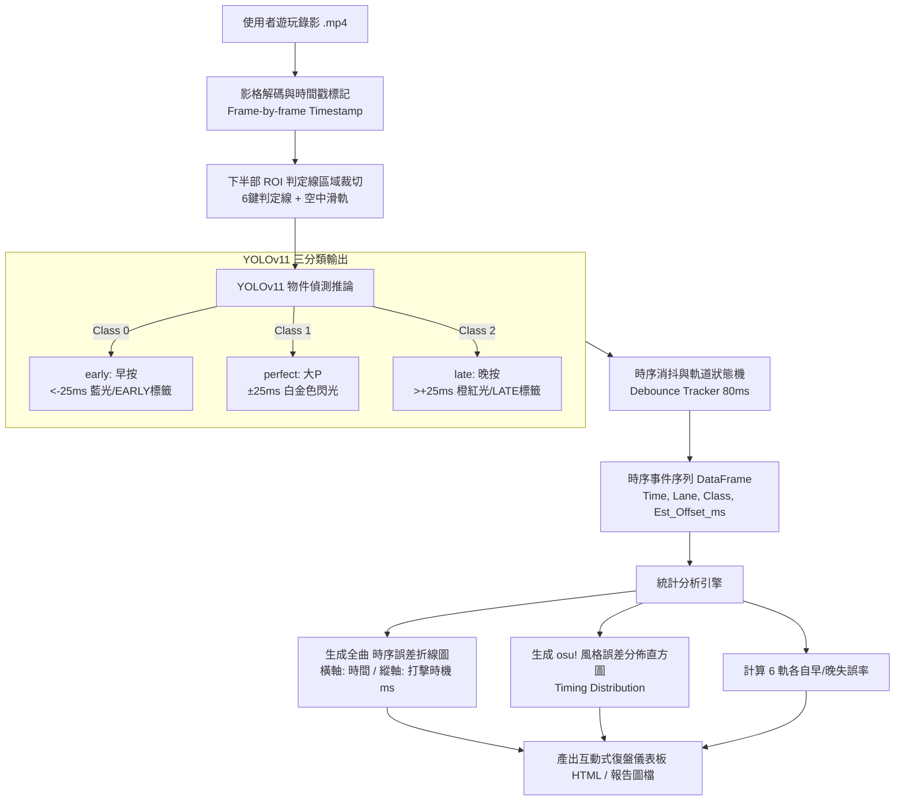

# In Falsus 影像辨識復盤系統 — 系統規劃與實作規格書 (Project Specification)

> **專案主題**：遊戲 *In Falsus* 的影像辨識復盤系統  
> **設計作者**：資訊三丙 吳昱霖  
> **系統定位**：透過 YOLOv11 物件偵測與時序分析，將玩家遊玩錄影自動轉化為專業級音遊復盤報告。核心聚焦於**「歌曲時間 vs. 打擊時機」時序折線圖**，並以 *In Falsus* 官方社群與 lowiro 引擎標準之**「大 P 判定區間（±25ms）」**作為分類基準，將打擊狀態精簡分類為 **`early`、`perfect`、`late`** 三大類。

---

## 一、 調研結果：In Falsus「大 P」判定區間與分類指標

### 1. 遊戲底層引擎與判定標準 (lowiro Timing Window)
*In Falsus* 為 lowiro（知名音遊 *Arcaea* 開發商）推出的 PC 節奏冒險遊戲。綜合社群資料庫（Miraheze In Falsus Wiki、WIKIWIKI）與 lowiro 遊戲引擎判定架構：

* **大 P (Shiny EXACT / Critical Perfect)**：
  * **時間窗口：$\mathbf{\pm 25\text{ ms}}$**（在 $\pm 25\text{ ms}$ 絕對精確範圍內擊中）。
  * **遊戲反饋**：觸發金色/白亮彩光特效，獲得滿分 + 額外 1 分加分（Bonus），結算達成最高評價「PERFECT DIVE (PD)」，畫面上**不出現** Early/Late 警告。
* **Early (偏快 / 早按)**：
  * **時間窗口：低於 $\mathbf{-25\text{ ms}}$**（通常落於 $-25\text{ ms} \sim -50\text{ ms}$ 或前置 NEAR 範圍）。
  * **遊戲反饋**：畫面上方跳出藍色/青色 `EARLY` 提示，或結算記為小 Exact/Near。
* **Late (偏慢 / 晚按)**：
  * **時間窗口：高於 $\mathbf{+25\text{ ms}}$**（通常落於 $+25\text{ ms} \sim +50\text{ ms}$ 或後置 NEAR 範圍）。
  * **遊戲反饋**：判定線上跳出橙紅色擊打光效、`LATE` 提示，或結算記為小 Exact/Near。（註：畫面頂部之負數為 Miss HP 血量扣減懲罰，判定全權聚焦於判定線 ROI）。
* **斷連 (Break / Miss)**：超過 $\pm 100\text{ ms}$ 或未擊打。

### 2. 模型分類精簡：三類設計 (`early`, `perfect`, `late`)
為了最大化模型準確度、降低標註負擔，並直接對準玩家練琴/練歌的核心痛點，系統將模型檢測目標精簡統一為三大類：

| 類別 (Class) | 判定名稱 | 判定毫秒範圍 | 視覺特徵 (Visual Clue) | 復盤意義 |
| :--- | :--- | :--- | :--- | :--- |
| **`perfect`** | 大 P (Critical Exact) | **$[-25\text{ ms}, +25\text{ ms}]$** | 白金色/彩虹閃爍光效、無 Early/Late 偏移標籤 | 節奏穩定，標準擊打點 |
| **`early`** | 早按 (Fast / Early) | **$<-25\text{ ms}$** | 藍青色擊打光效、畫面上方或按鍵旁浮現 `EARLY` | 搶拍、手指過於緊張急躁 |
| **`late`** | 晚按 (Slow / Late) | **$>+25\text{ ms}$** | 橙紅色擊打光效、畫面上方浮現 `LATE` | 拖拍、手速跟不上密集配置 |

---

## 二、 核心可視化成果：歌曲時間 vs 打擊時機 時序折線圖

本專案最終將匯出音遊選手專用的**「全曲擊打時序折線散點圖（Timing Deviation Timeline）」**：

### 1. 座標軸定義
* **橫軸（X 軸）：歌曲時間 (Song Time)**
  * 格式為分:秒（如 `00:00`, `00:30`, `01:00`, `01:30`, ...）或絕對秒數。
  * 完整覆蓋整首樂曲從開始到結束的擊打過程。
* **縱軸（Y 軸）：打擊時機偏移量 (Hit Timing Error, ms)**
  * 數值範圍：$-60\text{ ms} \sim +60\text{ ms}$，原點 $0\text{ ms}$ 為標準拍點。
  * **大 P 安全區間帶 (Perfect Zone)**：在 Y 軸 $[-25\text{ ms}, +25\text{ ms}]$ 區間繪製淺綠色背景帶，代表大 P 命中區。
  * **上方區域 ($>+25\text{ ms}$)**：淺紅色背景，代表 **Late (偏慢)**。
  * **下方區域 ($<-25\text{ ms}$)**：淺藍色背景，代表 **Early (偏快)**。

### 2. 圖表視覺呈現規範
* **擊打散點 (Scatter Points)**：
  * 綠色圓點（●）：落在 $[-25\text{ ms}, +25\text{ ms}]$ 的 `perfect` 擊打。
  * 藍色倒三角（▼）：落在 $<-25\text{ ms}$ 的 `early` 擊打。
  * 紅色正三角（▲）：落在 $>+25\text{ ms}$ 的 `late` 擊打。
* **趨勢折線 (Trend Line / Rolling Mean)**：
  * 使用滑動平均線（Moving Average，窗口約 3~5 秒）將打擊點連成一條動態平滑折線。
  * **判讀價值**：
    * 折線若持續下沉至 $<-25\text{ ms}$，代表玩家在該段落「嚴重搶拍（急了）」。
    * 折線若持續上揚至 $>+25\text{ ms}$，代表玩家在該段落「讀譜延遲或手速不足（跟不上）」。
    * 折線若貼合 $0\text{ ms}$ 水平軸微幅震盪，代表節奏感極佳。

---

## 三、 架構選型決策：採用「方法二（影片錄影離線分析）」

| 比較項目 | 方法一：即時監控 (Real-time) | 方法二：影片離線分析 (Video Post-Analysis) | 結論 |
| :--- | :--- | :--- | :--- |
| **遊玩干擾度** | 高。背景即時推論易引發微卡頓（Micro-stutter），破壞音遊手感。 | **零干擾**。遊玩時僅需顯卡硬體錄影，推論完全在遊戲後進行。 | **方法二勝** |
| **判定漏幀率** | 高。FPS 稍有波動即可能遺漏持續僅 30~50ms 的特效。 | **零漏幀**。逐影格（Frame-by-frame）解碼，不遺漏任何擊打。 | **方法二勝** |
| **精確時序對齊** | 需處理系統時鐘同步問題。 | 透過影格時間戳直接對齊到毫秒（ms）。 | **方法二勝** |
| **圖表支援** | 即時難以回溯整首歌。 | 輕鬆計算全曲滑動平均與產出互動式折線圖。 | **方法二勝** |

---

## 四、 系統推論與時序狀態機處理流程

---

## 五、 時序狀態機 (Tracker) 與 誤差值 (ms) 推估邏輯

1. **空間映射 (Spatial Mapping)**：
   * 偵測框中心點 $(x_c, y_c)$ 落入下半部 6 個等分槽位（Lane 1 ~ Lane 6）或空中滑軌。
2. **時序消抖 (Debounce 80ms)**：
   * 同一軌道在 80ms 內出現的同類框視為同一擊打事件，只記錄首幀時間點，防止連幀重複計算。
3. **打擊時機 (Timing Offset, ms) 估算**：
   * 若模型識別為 `perfect`：打擊時機點落在 $[-10\text{ ms}, +10\text{ ms}]$ 區間（中心值記為 $0\text{ ms}$）。
   * 若模型識別為 `early`：打擊時機點落在 $[-50\text{ ms}, -25\text{ ms}]$ 區間（代表偏快搶拍）。
   * 若模型識別為 `late`：打擊時機點落在 $[+25\text{ ms}, +50\text{ ms}]$ 區間（代表偏慢拖拍）。
   * 判定線完全聚焦於下方 ROI：模型根據判定特效外觀與文字標註直接輸出 `early`、`perfect`、`late` 三大類別。

---

## 六、 預期成果交付物

1. **時序誤差折線圖 (`timing_timeline.png` / 互動式 HTML)**：
   * 橫軸為歌曲時間軸，縱軸為打擊時機（ms），清楚標出 $\pm 25\text{ ms}$ 大 P 綠色安全帶，一眼揪出玩家在哪個小節搶拍或拖拍。
2. **三分類統計總表 (`summary.json`)**：
   * `perfect`（大 P 數）、`early`（早按數）、`late`（晚按數）之總量與百分比。
   * 大 P 率（Critical Perfect Rate）計算。
3. **6 鍵弱點診斷表**：
   * 分析 Lane 1 至 Lane 6 各鍵位的偏快/偏慢比例（例如：Shift 鍵容易 Late，S 鍵容易 Early）。

---
*本規劃書已將模型精簡為 `early` / `perfect` / `late` 三類，並鎖定 In Falsus 官方大 P 區間（±25ms）作為基準指標。*
